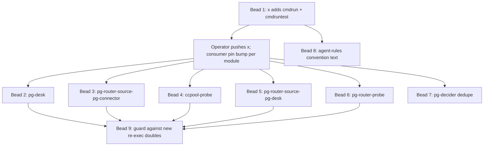

# ADR-0001: A shared in-process command-runner seam in x (adopt in part)

**Status**: Proposed (recommendation from spike `pg2-8q541l`; awaiting operator decision)
**Date**: 2026-10-27
**Deciders**: phillipg (pending)

## Recommendation

**Adopt in part.** Add one small, standard-library-only package pair to `x`
(`github.com/phillipgreenii/x`): a process-spawn core (`Call`, `Result`, `Runner`, `Exec`) and an
in-process fake with an ordered call log, plus a shared contract suite for the real `Exec`.
Migrate only the packages whose tests stand in for an external tool by re-executing the test
binary, in order of measured gain. Do **not** sweep the interface-style `Runner` types that already
have in-process fakes, and do **not** try to remove the re-exec tests whose subject is a real
process (`pg-rescue` and `scriptout/conformance`; `claude-hook-router` and `scriptout/exec_test.go`
do not re-execute, see the class B correction in decision 1).

## Context

On 2026-10-26 the `run-unit-tests` hook for `nix-agent-support` took 1980 s and
`packages/pg-decider` hit the 300 s `pg-test-runner` cap with every test passing. The cost was the
test double: `apply.Env.Command` was a `CmdFactory` that had to return a real `*exec.Cmd`, so the
tests re-executed the race-built test binary (`GO_WANT_HELPER_PROCESS`) once per fake call.

Two facts changed between the bead's evidence and this spike:

1. **The pg-decider fix has already landed on `main`** (commit `c1911c5c8`, 2026-10-26 16:16 -04:00,
   an ancestor of `main` at `508c3b95d`). `apply.Env.Command` and `view.ExecCommand` no longer
   exist; both were replaced by a `Runner` func. The commit's own measurement (`go test -race
-count=1 -p 4`, wall per package): `internal/apply` 289.7 s to 1.5 s, `cmd/pg-decider` 149 s to
   2.4 s, `internal/view` 4.3 s to 1.3 s.
2. That fix **copied** the seam instead of sharing it: `pg-decider` now holds four near-identical
   copies (`internal/prchange/exec.go`, `internal/backfill/exec.go`, `internal/apply/runexec.go`,
   `internal/view/runexec.go`; 71 + 62 + 81 + 74 = 288 lines). The commit message says the three
   `Call`/`Result` shapes were kept identical "so a later merge is mechanical".

### Verification of the bead's claims

| Claim in the bead                                             | Finding (read from code, 2026-10-27)                                                                                                                                                                                                                                 |
| ------------------------------------------------------------- | -------------------------------------------------------------------------------------------------------------------------------------------------------------------------------------------------------------------------------------------------------------------- |
| Test files containing `GO_WANT_HELPER_PROCESS`, listed by pkg | `rg -l GO_WANT_HELPER_PROCESS -g '*_test.go'` on the canonical clone: **21** in `nix-agent-support` today. At `c1911c5c8^` it was **26** (the bead's 12 + 5 + 3 + 6): the 5 `pg-decider` files are gone. **0** in the other four repos and in `x`.                   |
| `apply.Env.Command` is a `CmdFactory` returning `*exec.Cmd`   | True at `c1911c5c8^` (`internal/apply/hook.go`). On `main` it is `Env.Runner Runner`; `nil` means `ExecRunner`.                                                                                                                                                      |
| "About 15" separately declared `Runner`/`Executor` types      | A regex for `^type \w*(Runner\|Executor\|CommandRunner\|CmdFactory)\w* (interface\|func)` on non-test `.go` files matches **39** (33 in `nix-agent-support`, 2 in `nix-repo-base`, 4 in `nix-support-apps`). Some are not process seams; I hand-compared 12 (below). |
| `modules/pg-test-runner/config.nix` raises the cap for six    | It lists **seven** (`claude-extended-tool-approver`, `df-survey`, `pn`, `pg-desk`, `pg-router`, `pg-connector`, `pg-router-handlers`). Only the `pg-desk` entry is consistent with this cost (see "Measured cost").                                                  |
| `x` holds only seven packages                                 | Confirmed: `gitclient`, `gitfixture`, `gittest`, `jsonllogger`, `osdirs`, `otelsetup`, `pprofserver`.                                                                                                                                                                |

The same seam as `CmdFactory` (`var execCmdFactory = exec.CommandContext`, swapped by tests to
return a re-exec command) still exists in **11 non-test files** in `nix-agent-support`
(`ccpool-probe` x2, `pg-connector/pkg/scriptout` x2, `pg-desk` x3, `pg-router-probe` x2,
`pg-router-source-pg-connector`, `pg-router-source-pg-desk`).

The wider re-exec idiom (any `-test.run` string in a `.go` file) matches 38 files in
`nix-agent-support`, 1 in `nix-repo-base` and 3 in `nix-support-apps`. I did not classify those;
they are NOT counted as doubles below.

### Measured cost

Commands (single run each, `nice -n 10 go test -p 4 -count=1`, `GOPROXY=off`, a warm build first so
the figure is the test run; the host was shared with other sessions and its load was not
recorded). Package time is the `ok ... N s` figure `go test` printed:

| Package (module under `nix-agent-support/packages/`) | `-race` (s) | no `-race` (s) | Class (below) |
| ---------------------------------------------------- | ----------: | -------------: | ------------- |
| `pg-desk/internal/sync`                              |       253.9 |            1.6 | A             |
| `pg-desk/internal/gather`                            |       208.7 |            1.4 | A             |
| `pg-router-source-pg-connector/cmd/...`              |        90.2 |            2.1 | A             |
| `pg-rescue/internal/runner`                          |        84.4 |           24.0 | B             |
| `claude-hook-router/internal/router`                 |        44.8 |            3.9 | B             |
| `pg-connector/pkg/scriptout`                         |        35.0 |            5.6 | B             |
| `ccpool-probe/cmd/ccpool-probe`                      |        23.1 |            1.0 | A             |
| `pg-router-source-pg-desk/cmd/...`                   |        15.6 |            4.1 | A             |
| `pg-router-probe/cmd/pg-router-probe`                |        15.3 |            4.8 | A             |

Calculation for class A (the packages a shared runner would change):
`208.7 + 253.9 + 90.2 + 15.6 + 15.3 + 23.1 = 606.8 s` under `-race`, against
`1.4 + 1.6 + 2.1 + 4.1 + 4.8 + 1.0 = 15.0 s` without. This is a SUM of package times, not a module
wall time (`-p 4` runs packages in parallel), so it is a size indicator, not a prediction.

The mechanism, reproduced with a throwaway module outside the repo (a test running `sh -c true` 20
times and re-executing its own test binary 3 times):

| Child                                | no `-race`             | `-race`                |
| ------------------------------------ | ---------------------- | ---------------------- |
| `sh -c true` (not a race-built tool) | 182.4 ms / 20 = 9.1 ms | 175.7 ms / 20 = 8.8 ms |
| re-exec of the test binary           | 12.75 ms / 3 = 4.2 ms  | 3.032 s / 3 = 1.01 s   |

So the penalty belongs to a **race-built child**, not to spawning. A real `sh`, `git` or a shell
script on `PATH` costs milliseconds under `-race`; only re-executing the test binary costs a flat
second per call. (`work-report/internal/pgconn/fake` already uses a shell-script fake and so never
paid it.)

**Not measured:** the other 12 class A and B test files' packages (`pg-desk/internal/beadref`,
`cmd/pg-desk`, the `pg-rescue/cmd/*`, `contracttest` and `orphan` packages); the module wall time
with `-p 4` for any module; whether the `pg-desk` 900 s cap is caused entirely by this (it is
consistent: the cap's own note says `~211s standalone`, and `gather` alone measured 208.7 s, but I
did not remove the helper and re-run); any non-`-race` effect of the other six capped projects.

## Compared types

Read from the code, not from the bead. "Call log" means the repo's own fake for that seam.

| Type (location)                                                                      | Shape                                                                                        | stdin                        | env                                                 | Cancel / signal mapping                                                                                        | Start error vs non-zero exit                                                             | stdout / stderr                                | Ordered call log in the fake                                                     |
| ------------------------------------------------------------------------------------ | -------------------------------------------------------------------------------------------- | ---------------------------- | --------------------------------------------------- | -------------------------------------------------------------------------------------------------------------- | ---------------------------------------------------------------------------------------- | ---------------------------------------------- | -------------------------------------------------------------------------------- |
| `pb` `internal/run` `Runner` + `CLIRunner`                                           | interface, `Run(ctx, name, args, Options) (Result, error)`                                   | `Options.Stdin string`       | `Options.Env` full replace (nil inherits)           | `Timeout>0`: own process group, whole group SIGKILL, `ErrTimeout`; plain cancel only kills the child           | non-zero exit: error AND `Result.ExitCode`; start error: wrapped error ("is X on PATH?") | `string`, both                                 | `FakeRunner.Calls()`; scripted by name+args, consumed in order; unscripted fails |
| `beads-exporter` `internal/bd` `Runner` + `ExecRunner`                               | interface, `Run(ctx, Cmd) (Result, error)`                                                   | none                         | `Cmd.Env` is the COMPLETE environment, never merged | process-group SIGKILL on cancel (`WaitDelay` 2 s); returns `ctx.Err()`                                         | non-zero exit is NOT an error (`ExitCode`); start error is `err`                         | `[]byte`, both                                 | test doubles hand-written (`guardn` counts and records `Cmd`)                    |
| `work-report` `internal/pgconn` `Runner` (+ optional `DetailedRunner`)               | interface, `Run(ctx, args...) (stdout, exit, err)`; binary fixed to `pg-connector`           | none                         | none                                                | returns `ctx.Err()` when the context ended                                                                     | non-zero exit is data (nil err); start error is `err`                                    | `Run`: stdout only; `RunDetailed`: both        | `pgconn/fake`: shell script on `PATH`, argv-prefix routes, recorder file         |
| `pg-router` `internal/wireclient` `Runner` + `OSRunner`                              | interface, `Run(ctx, argv, stdin) (stdout, exit, err)`                                       | `[]byte`                     | none                                                | no mapping: a killed child is an `ExitError`, so it returns exit `-1` with a NIL error; `WaitDelay` 3 s        | non-zero exit is data (nil err); start error wrapped                                     | stdout captured; stderr FORWARDED to a writer  | test fakes per test file                                                         |
| `nix-repo-base` `modules/pn/internal/exec` `Runner` + `realRunner`                   | interface, `Run(ctx, name, args, RunOptions) (Result, error)`; decorator stack (trace, wrap) | `io.Reader`                  | `RunOptions.Env map[string]string`, adds/overrides  | `Result.Signal` names the signal (exit `-1`); `OwnProcessGroup` makes cancel reach the whole group; kill grace | non-zero exit: `*CommandError` (carries `Result`); start error: `err`                    | `[]byte`, both, plus live tee writers          | `FakeRunner.Calls()` + `Reset()`; scripted by name+args                          |
| `nix-repo-base` `modules/jira/pkg/pjira` `Runner` (impl in `cmd/pjira/main.go`)      | interface, `Run(ctx, argv) (stdout, err)`; `exec.CommandContext(...).Output()`               | none                         | none                                                | none (default `CommandContext` kill)                                                                           | any non-zero exit is `err`                                                               | stdout only                                    | per-test stub                                                                    |
| `nix-support-apps` `host-activity/internal/actionrun` `CommandRunner` + `ExecRunner` | interface, `Run(ctx, Command) (int, error)` plus `Signal(pid, sig)`                          | `io.Reader`                  | `Env` appended, or `ExactEnv` replace               | signal death reported as `128+N`, nil err; `OnStart(pid)` lets the caller forward signals                      | non-zero exit is the int (nil err); start error is `err`                                 | streamed to caller writers (TTY), not captured | per-test fakes (`scriptCmd`, `pbcopyFake`)                                       |
| `pg-decider` `internal/prchange` `Runner` (func) + `ExecRunner`                      | `func(ctx, Call) Result`; `Call{Name, Args, Stdin, Env}`                                     | `string`                     | appended to `os.Environ()`                          | `Result.Signaled`, `Code -1` when killed by a signal OR the context ended                                      | `Result.StartErr` separate from `Code`                                                   | `string`, both                                 | test-local doubles (rule lists, first-match, Nth, `{seq}`, mutex-guarded log)    |
| `pg-decider` `internal/backfill` `Runner` (func)                                     | same, but `Call` has `Dir`, no `Stdin`; `Result` has no `Signaled`                           | none                         | appended                                            | `Code -1`, no `Signaled`                                                                                       | `StartErr`                                                                               | `string`, both                                 | test-local                                                                       |
| `pg-decider` `internal/apply` `Runner` / `internal/view` `Runner` (post-fix)         | identical to `prchange` except the result type is `CallResult`                               | `string`                     | appended                                            | as `prchange`                                                                                                  | as `prchange`                                                                            | `string`, both                                 | `newDouble` / `withHelper` call recording                                        |
| `pg-decider` `apply.Env.Command` `CmdFactory` (pre-fix, `c1911c5c8^`)                | `func(ctx, name string, args ...string) *exec.Cmd`                                           | whatever the `*exec.Cmd` has | whatever the `*exec.Cmd` has                        | none: the caller owns the command                                                                              | the caller runs it, so every consumer maps outcomes itself                               | caller wires                                   | a re-exec of the test binary; call log via `GO_HELPER_LOG`                       |

What the table shows:

- **The runners that already take values in and out (`pb`, `bd`, `pn`, `pgconn`, `wireclient`,
  `actionrun`, `pg-decider`) are already in-process-fakeable.** None of them re-executes a test
  binary. Their contracts differ on exactly the points that matter to their callers: cancel is an
  error (`bd`, `pgconn`), exit `-1` with no error (`wireclient`), `Signaled` (`pg-decider`),
  `Signal` name (`pn`), or `128+N` (`actionrun`); a non-zero exit is an error (`pb`, `pjira`, `pn`)
  or data (the rest). Forcing them onto one `Result` would change behaviour a caller relies on
  (the comment on `prchange.Result.Signaled` says the router reads "signal: killed" as a transient
  failure).
- **The `CmdFactory` seam is the defect.** A seam that returns `*exec.Cmd` cannot be answered in
  process, so the only double is a real process. It is also the seam that spreads by copy: the
  headers of `ccpool-probe/.../testmain_test.go`, `pg-router-source-pg-connector/.../testmain_test.go`,
  and `pg-rescue/internal/runner/helper_test.go` each say they mirror a sibling's
  `testmain_test.go`, which says it mirrors `pg-connector/pkg/scriptout/exec_test.go`.

## Decision points

### 1. Is a shared package worth it?

Options:

- **(a) Leave each package's own `Runner`.** Works: `c1911c5c8` migrated `pg-decider` in one commit
  (19 files, whole module 14 s under `-race`). Costs: it produced four copies in one module within a
  day; every new package starts from the nearest example, which is the re-exec pattern (above);
  each copy re-implements the cancel/signal mapping and the `sh -c` tests that pin it (`apply` and
  `view` each carry a `runexec_test.go`, 144 and 81 lines).
- **(b) Shared `Call`/`Result`/`Runner`/`Exec` plus a fake in `x`** (the `gittest` pattern). Removes
  the copies, gives the next package the in-process seam by import rather than by copying a
  neighbour, and gives every test one fake with the same call-log and rule semantics. Costs: a
  pin bump per consumer (point 4); a shape that must be the union of what the CmdFactory-seam
  packages need.
- **(c) A shared contract suite every `Exec` implementation must pass.** Tests the thin real
  wrapper once instead of in every copy. Only valuable together with (b): if every consumer uses
  `x`'s `Exec`, the suite runs once in `x`; a consumer that keeps its own wrapper (an adapter,
  for example to keep `bd`'s "non-zero exit is not an error") runs the same suite against it.

**Recommendation: (b) and (c) together, scoped to the CmdFactory-seam packages; (a) remains correct
for the interface-style runners.** The deciding facts: all 21 current re-exec test files are in
`nix-agent-support`; 7 of them (class A below) fake an external tool and gain 606.8 s to 15.0 s of
measured package time; the pattern is propagated by copying; and the copy that was just made is
already four-fold. The reason not to go further is that the seven interface-style runners have
different, caller-visible contracts and already have fast fakes, so a sweep would cost churn and
risk behaviour changes for no test-time gain.

Classification of the 21 files (from reading the seam and the helper header; I did not read every
test body):

- **Class A, a stand-in for an external tool (7 files, 5 modules).** `pg-desk` (3:
  `gather_test.go`, `sync_test.go`, `beadref_test.go`), `pg-router-source-pg-connector`,
  `pg-router-source-pg-desk`, `pg-router-probe`, `ccpool-probe`. Each replaces
  `execCmdFactory = exec.CommandContext` with a function returning a re-exec command and answers
  from a `GO_HELPER_BEHAVIOR` switch. A `Runner` returning a canned `Result` replaces it.
- **Class B, the process is the unit under test (14 files).** `pg-rescue` (12): the wrapper
  supervises a real child, process groups and signals, and `cmd/pg-rescue-notify/main_test.go`
  re-executes the test binary AS the real `main`. `claude-hook-router/.../dispatch_test.go` tests a
  delegate that leaves a grandchild holding the pipe open. `pg-connector/pkg/scriptout/exec_test.go`
  tests the Tier-2 backend exec path itself. A `Runner` double cannot replace these; they exercise
  the real `exec`. They are multi-process tests, so under V-4 they belong behind a build tag with
  their own check, not in the unit gate (a follow-up, not part of this decision).

  **Correction (bead `pg2-rwfuej`, from ADR 0111 in `nix-agent-support`, read against the code at
  `aa01f65ca`, 2026-10-28):** the class B list above overstates what re-executes the test binary.
  - `claude-hook-router` does NOT re-execute the test binary (no `GO_WANT_*`, no `TestHelperProcess`,
    no `os.Args[0]`; its delegates are `sh -c` one-liners). It is a V-3 single-process real-tool
    suite and stays a unit test.
  - `pg-connector/pkg/scriptout/exec_test.go` does NOT re-execute anything: an in-process backend
    double replaced the re-exec, and the literal `GO_WANT_HELPER_PROCESS` there is only a comment.
    The re-exec that remains under `scriptout` is in the `conformance` sub-package
    (`conformance_test.go`, two tests, env name `GO_WANT_CONFORMANCE_HELPER_PROCESS`, helper
    `TestHelperProcess`, binary `os.Args[0]`).
  - `pg-rescue` re-executes only in five test files of its `cmd/*` mains
    (`cmd/pg-rescue/main_test.go`, `cmd/pg-rescue/flakelock_handler_test.go`,
    `cmd/pg-rescue-bead/main_test.go`, `cmd/pg-rescue-claude/main_test.go`,
    `cmd/pg-rescue-notify/main_test.go`, all `GO_WANT_HELPER_PROCESS`). `pg-rescue/internal/runner`
    no longer does: its `TestMain` builds the fake command once WITHOUT the race detector
    (`testenv.BuildHelper`, bead `pg2-cp2dfo`) and starts it as an ordinary child process.

  The class B list, meaning the suites that re-execute the test binary, is therefore `pg-rescue`
  (the `cmd/*` files, not `internal/runner`) and `pg-connector/pkg/scriptout/conformance`, six
  files in all, not 14. The 14-file count above is the 2026-10-27 snapshot and is kept as history.

### 2. What the shared shape must cover

Derived from the table, not from the bead's candidate list. v1 MUST cover only what the class A
packages need and what at least two compared types already share; everything else MAY wait.

| Capability                                                         | v1              | Evidence                                                                                                                                                                                   |
| ------------------------------------------------------------------ | --------------- | ------------------------------------------------------------------------------------------------------------------------------------------------------------------------------------------ |
| stdin                                                              | MUST            | `pb`, `wireclient`, `pn`, `actionrun` and `pg-decider` `prchange`/`apply`/`view` take it; `bd`, `pgconn`, `pjira`, `backfill` do not.                                                      |
| extra env, appended; and exact env                                 | MUST            | append: `pg-decider`, `actionrun`, `pn`; exact: `bd`, `actionrun` (`ExactEnv`), `pb` (full replace).                                                                                       |
| working directory                                                  | MUST            | `pb`, `pn`, `actionrun` and `pg-decider/backfill` take it; `bd`, `pgconn`, `wireclient` do not.                                                                                            |
| cancel and signal mapping                                          | MUST            | One result that reports BOTH "ended by a signal (name when known)" and "the context ended", so an adapter can produce `ctx.Err()`, `Signaled`, `128+N` or exit `-1` as its caller expects. |
| start error vs non-zero exit                                       | MUST            | Separate fields (`StartErr` vs `Code`); the `pg-decider` shape already does this and `bd`/`pgconn` document it as the load-bearing split.                                                  |
| stdout and stderr capture                                          | MUST            | Captured separately, never interleaved (`source-pg-connector/exec.go` states why). `[]byte` (5 of 8 compared shapes use it; `string`: `pb`, `pg-decider`).                                 |
| ordered call log, concurrency-safe                                 | MUST            | `pb`/`pn` `FakeRunner.Calls()`, `pgconn/fake` recorder, `pg-decider` mutex-guarded log (the apply double is called from goroutines).                                                       |
| fake rules: first match, Nth call, sequence, fail-loud on no match | MUST            | `pg-decider` double (first-match, Nth, `{seq}`), `pb`/`pn` (unscripted call fails).                                                                                                        |
| own process group and group kill on cancel                         | SHOULD (opt-in) | `pb`, `bd`, `pn` need it; `pn` documents costs (a tty-reading child is stopped by SIGTTIN), so it MUST default off.                                                                        |
| live stdout/stderr tee writers                                     | MAY (not v1)    | only `pn` and `actionrun`; those keep their own runner.                                                                                                                                    |
| `OnStart(pid)`, `Signal(pid, sig)`                                 | MAY (not v1)    | only `actionrun`.                                                                                                                                                                          |
| decorators (trace, `WrapNix`)                                      | MUST NOT        | `pn`-specific; stays in `pn`.                                                                                                                                                              |

A non-normative sketch of the core, one code block per file (final names belong to the package
bead; `gittest`/`gitfixture` are the naming precedent):

```go
// cmdrun/cmdrun.go (core, no testing import)
package cmdrun

type EnvMode int

const (
	EnvAppend EnvMode = iota // Env is added to os.Environ()
	EnvExact                 // Env is the whole environment
)

type Call struct {
	Name         string
	Args         []string
	Dir          string
	Stdin        []byte
	Env          []string
	EnvMode      EnvMode
	OwnProcGroup bool // opt-in: kill the whole group on cancel
}

type Result struct {
	Stdout, Stderr []byte
	Code           int    // -1 when ended by a signal or the context
	Signal         string // name when known, "" otherwise
	CtxErr         error  // ctx.Err() when the context ended the child
	StartErr       error  // the child never started
}

type Runner func(ctx context.Context, c Call) Result

func Exec(ctx context.Context, c Call) Result
```

```go
// cmdrun/cmdruntest/fake.go (imports testing, the gittest-style adapter)
package cmdruntest

type Fake struct{ /* mutex, rules, ordered log */ }

func New(t testing.TB) *Fake
func (f *Fake) On(match func(cmdrun.Call) bool) *Rule   // first match wins; Rule.Times(n), Rule.Seq(...)
func (f *Fake) Runner() cmdrun.Runner                    // unmatched call fails the test loudly
func (f *Fake) Calls() []cmdrun.Call                     // ordered

// RunContract exercises a Runner against real sh: exit codes, stdout/stderr split, stdin, env
// modes, signal and context cancel, start error. Adapters that wrap Exec call it from their tests.
func RunContract(t *testing.T, r cmdrun.Runner)
```

Two repo-convention consequences for `x` itself: `x/README.md` says untagged tests spawn no
subprocess, so the real-`Exec` tests MUST sit behind the `integration` tag (the fake's own tests
stay untagged); and `x`'s CI coverage gate (aggregate of all three tiers, at least 90.0%) already
counts them.

### 3. Migration cost and order

The change per class A package is bounded and has a worked example (`c1911c5c8`): replace the
`CmdFactory` variable with a `cmdrun.Runner`, turn the helper's behaviour switch into a function
returning a `Result` (that commit kept the `GO_HELPER_*` settings so `withHelper` call sites did
not change), delete the re-exec `TestMain` branch, and keep a handful of real-`sh` tests for
exit-code, env, signal and missing-binary mapping (now `RunContract`). It is **not a codemod**:
each `helperMain` has bespoke behaviours (hang, sleep, partial output, env recording) that need a
person to map them onto fake rules. The right unit is one bead per module, with a shared recipe.

Order, by measured gain (package race time from the table; "seams" counted above):

| Order | Module                                    | Seams | Measured `-race` gain (s) | Notes                                                                                    |
| ----: | ----------------------------------------- | ----: | ------------------------: | ---------------------------------------------------------------------------------------- |
|     1 | `pg-desk`                                 |     3 |    462.6 for two packages | largest; `beadref` and `cmd/pg-desk` not measured; module already depends on `x`         |
|     2 | `pg-router-source-pg-connector`           |     1 |         88.1 (90.2 - 2.1) | `exec.go` also appends env after the factory set it, which a `Runner` removes            |
|     3 | `ccpool-probe`                            |     2 |                      22.1 |                                                                                          |
|     4 | `pg-router-source-pg-desk`                |     1 |                      11.5 |                                                                                          |
|     5 | `pg-router-probe`                         |     2 |                      10.5 |                                                                                          |
|     6 | `pg-decider` (dedupe four copies)         |     0 |       none (already fast) | gain is 288 lines to one import and one fake; adds `x` as a NEW dependency of the module |
|   opt | interface-style runners (`pb`, `bd`, ...) |   n/a |                      none | MAY adapt opportunistically; MUST NOT be a sweep                                         |



### 4. Where it lives

**In `x`.** The consumers span three repos: re-exec doubles are in `nix-agent-support`, but the
compared runners also live in `nix-repo-base` (`pn`, `pjira`) and `nix-support-apps`
(`actionrun`), and 22 of the 43 Go modules in those three repos already depend on `x`.
`nix-agent-support` packages are separate Go modules joined by local `replace` directives (for
example `pg-desk` `replace`s `pg-connector` with `../pg-connector`), so a package placed there would
not reach the other two repos at all; a shared runner there would be shared in name only. `x` also
already carries the neighbouring precedent: `gittest`/`gitfixture` (a hermetic fixture used
through the `Tests That Need Git` rule in `code-file-standards.md`) and `gitclient` (its own
allowlisted `exec`, `x/gitclient/client.go`).

The cost is the pin bump. Grounded in the files:

- `x/go.mod` requires only OpenTelemetry modules; a standard-library package adds nothing to any
  consumer's dependency graph.
- Consumers pin a pseudo-version, for example `pg-desk/go.mod` has
  `github.com/phillipgreenii/x v0.0.0-20261025041111-c7b4ad60c6c2`, and `gomod2nix.toml` repeats it
  with a `hash`. A consumer sees a change in `x` only after `go get ...@<sha>`, `go mod tidy` and
  `update-deps.sh` (which runs `gomod2nix generate --with-deps`) in that module.
- The 22 `go.mod` files carry **8 distinct pins** today (12 on `...20261015022436-7b4c351b3c34`,
  4 on `...20261025041111-c7b4ad60c6c2`, six singletons), so skew already exists and a new package
  does not force anyone: only the migrating modules bump.
- A bump pulls every `x` change between the old and new pin. `pg-desk` pins
  `c7b4ad60c6c2` while `x` HEAD is `cd0c6db` (and `pn` already pins `982f7edfdcbb`); the migration
  bead MUST read the `x` log between the pins, since unrelated changes (for example `otelsetup`)
  ride along.
- The new `x` commit MUST exist on the remote (`git@github.com:phillipgreenii/x.git`) before a
  consumer can resolve its pseudo-version. Agents do not push (rule U-5), so every migration bead
  has an operator step ahead of it; the beads below are ordered after bead 1 for that reason.
  I did not verify the consumers' `GOPRIVATE`/proxy setup.
- `pg-decider` does not depend on `x` today; its dedupe bead adds the dependency and a
  `gomod2nix.toml` entry.

The alternative that avoids the pin entirely is a package inside `nix-agent-support` reached by
`replace`. It is cheaper for the five class A modules (all in that repo) and loses `pn`,
`pjira`, `actionrun` and any future package outside it. Declined because the pin cost is one-off per
module and the bead's own premise is that `x` is the workspace-wide module.

### 5. Is a guard against new re-exec doubles warranted?

**Yes, as a rule now and a mechanical check later.**

- **Rule (now, in the same change set as the package).** `code-file-standards.md` already has
  "Tests That Need Git" pointing at `x`. It SHOULD gain a parallel "Tests That Run An External
  Command" section: a test that stands in for an external tool MUST use the `x` runner fake; it
  MUST NOT re-execute the test binary (`GO_WANT_HELPER_PROCESS`, `-test.run=^TestHelperProcess$`) to
  fake a tool; a test whose subject is the real process (supervision, signals, a grandchild holding
  a pipe) MAY re-execute the test binary but is multi-process and MUST sit behind a build tag with
  its own check (V-4). The 1.0 s per call, the 9 ms per `sh`, and the `c1911c5c8` numbers are the
  rationale to cite.
- **Check (after the class A migrations).** Before migration a check fails on all 21 files, so it
  cannot be a gate yet. After, a check that flags `GO_WANT_HELPER_PROCESS` in any file lacking an
  `integration` (or equivalent) build tag is a one-line `rg` and costs nothing to run. It SHOULD
  be a hook, not a per-module test: `pg-connector/cmd/pg-connector/unit_tier_guard_test.go`
  already walks the AST per module, and at the time of this spike it ALLOWED "the
  re-exec-the-test-binary helper-process pattern (os.Args[0])" in the unit tier, which is the
  opposite of this rule, so the change adding the check MUST flip the allowance in the same commit
  (appendix bead 9; since done in `nix-agent-support`, commit `6435e88ea`). The hook MUST match
  every `GO_WANT_*HELPER_PROCESS` name, because `scriptout/conformance` uses
  `GO_WANT_CONFORMANCE_HELPER_PROCESS`, not `GO_WANT_HELPER_PROCESS`.
- **Why not a lint now:** a guard before the package exists forbids the only available pattern.

## Consequences

Positive: one tested spawn-and-map implementation instead of four-plus; a fake with the rules
`pg-decider` needed and a call log; the next package imports the in-process seam instead of copying
a neighbour's re-exec; class A tests drop from a measured 606.8 s to about 15.0 s of package time
under `-race` without changing `-race` defaults (out of scope and ruled by the operator,
2026-10-26).

Negative: a pin bump and an operator push per migrating module; a second shape for the
interface-style runners to live beside (they MAY adapt, they are not forced); `x` gains a package
whose real-`Exec` tests are subprocess tests behind a tag.

Neutral: class B is unchanged by this decision. Corrected by bead `pg2-rwfuej` (ADR 0111 in
`nix-agent-support`, checked against the code): only `pg-rescue` (five `cmd/*` test files, not
`internal/runner`) and `pg-connector/pkg/scriptout/conformance` (one file, env name
`GO_WANT_CONFORMANCE_HELPER_PROCESS`) re-execute the test binary; `claude-hook-router` and
`scriptout/exec_test.go` do not. Whether to tag the real re-exec suites as integration is a
separate question; `pg-rescue/internal/runner` took 24.0 s even without `-race` for reasons that are
not re-exec (wall-clock waits; ADR 0111, decision 1).

## Appendix A: proposed follow-up beads

The orchestrator files these; this spike creates none. Every migration bead's acceptance criteria
include "no `GO_WANT_HELPER_PROCESS` in the module's untagged test files" and "the module's unit
tier passes with `go test -race -p 4` and the package time is reported before and after".

1. **x: add `cmdrun` and `cmdruntest`** (repo `x`, label `x`). Scope: the core, fake and
   `RunContract` of point 2, README entry, tests. Acceptance: `go vet ./...`,
   `go test -race ./...` and `go test -race -tags integration,contract ./...` pass; real-`Exec`
   tests are behind `integration`; the aggregate coverage gate (at least 90.0%) holds; `RunContract`
   covers stdin, both env modes, working directory, non-zero exit, start error, signal death,
   context cancel (and process-group kill when opted in) against real `sh`; the fake supports
   first-match, Nth, sequence, concurrent calls and an unmatched call that fails the test. Depends
   on: none. Operator step: push `x`.
2. **pg-desk: replace the three re-exec doubles with the `x` runner** (repo `nix-agent-support`,
   label `agent-support`). Scope: `internal/gather`, `internal/sync`, `internal/beadref` seams and
   the matching helpers; also measure `beadref` and `cmd/pg-desk`. Acceptance: package times
   `gather` 208.7 s and `sync` 253.9 s under `-race` fall to the no-`-race` order (about 1.5 s each);
   no re-exec in untagged files; `go.mod`/`gomod2nix.toml` bumped. Depends on: bead 1 and the push.
3. **pg-router-source-pg-connector: same** (repo `nix-agent-support`). Acceptance: 90.2 s `-race`
   package time falls to the no-`-race` order (about 2 s); `--beads-dir` env passthrough still
   asserted. Depends on: bead 1.
4. **ccpool-probe: same** (two seams: ccpool and pg-connector). Baseline 23.1 s. Depends on: bead 1.
5. **pg-router-source-pg-desk: same.** Baseline 15.6 s. Depends on: bead 1.
6. **pg-router-probe: same** (two seams). Baseline 15.3 s. Depends on: bead 1.
7. **pg-decider: dedupe the four `Call`/`Runner`/`ExecRunner` copies onto `x`** (repo
   `nix-agent-support`). Priority lowest. Acceptance: one import replaces `prchange`, `backfill`,
   `apply` and `view` copies (288 lines); `backfill`'s `Dir` and the `Signaled` distinction keep
   their tests; `x` is added to `go.mod` and `gomod2nix.toml`. Depends on: bead 1.
8. **agent-rules: add "Tests That Run An External Command"** to `code-file-standards.md` (repo
   `nix-agent-support`), per point 5, citing the numbers above. Acceptance: the section uses RFC
   2119 language, states the class B exception and V-4 tagging, and links `x`. Depends on: bead 1
   (it names the package).
9. **Guard against new re-exec doubles** (repo to be chosen by the orchestrator: a hook in
   `nix-repo-base` or `nix-agent-support`). Scope (corrected by bead `pg2-rwfuej`): flag BOTH
   env names in an untagged test file, `GO_WANT_HELPER_PROCESS` and
   `GO_WANT_CONFORMANCE_HELPER_PROCESS` (the `scriptout/conformance` helper uses the second, which
   a check on the first literal would miss), that is, the pattern `GO_WANT_[A-Z0-9_]*HELPER_PROCESS`;
   and reverse the `os.Args[0]` allowance in
   `pg-connector/cmd/pg-connector/unit_tier_guard_test.go` (the guard's header then allowed "the
   re-exec-the-test-binary helper-process pattern (os.Args[0])" in the unit tier, which is the
   opposite of this rule). The guard MUST NOT ship with the allowance still in place, and the two
   MUST flip consistently in one change, or the module guard keeps blessing the pattern the new
   check forbids. Acceptance: the check passes on `main` once beads 2 to 6 land and the remaining
   real re-exec files (`pg-rescue` `cmd/*`, `scriptout/conformance`) are tagged (or explicitly
   allowlisted by path with a reason), and a seeded untagged re-exec file fails it, once per env
   name. Depends on: beads 2 to 6 and bead 10.

   Status (bead `pg2-rwfuej`, read from `nix-agent-support` at `aa01f65ca`): the guard has already
   landed there (bead `pg2-ty6mjm`, commit `6435e88ea`): the `no-reexec-test-doubles` hook
   (`scripts/check-no-reexec-test-doubles.sh`, pattern `GO_WANT_[A-Z0-9_]*HELPER_PROCESS`) with the
   path allowlist `scripts/reexec-test-double-allowlist.txt` (the five `pg-rescue` `cmd/*` files and
   `scriptout/conformance`), and the `os.Args[0]` allowance in `unit_tier_guard_test.go` is reversed
   (a re-exec is a violation unless the file is listed in `unitReexecAllowed`).

10. **Investigate tagging the class B re-exec suites as integration** (repo `nix-agent-support`;
    spike-sized). Scope (corrected by bead `pg2-rwfuej`): the suites that really re-execute,
    `pg-rescue` (the five `cmd/*` files) and `pg-connector/pkg/scriptout/conformance`. NOT
    `claude-hook-router` (no re-exec; a V-3 single-process suite that stays unit), NOT
    `scriptout/exec_test.go` (no re-exec; the string `GO_WANT_HELPER_PROCESS` is only a comment
    there) and NOT `pg-rescue/internal/runner` (builds its helper without the race detector; its
    cost is wall-clock waits, decided in ADR 0111, decision 1). Decide per suite whether it is a unit
    test (a few real-process cases, kept) or must move behind a tag with its own check (ADR 0024 in
    `nix-repo-base`). Acceptance: a written decision per package with the measured package time with
    and without `-race`. Done as spike `pg2-8h14y2` (ADR 0111 in `nix-agent-support`).

## Appendix B: what this spike did not verify

- The `pg-desk` `beadref` and `cmd/pg-desk` packages, and all `pg-rescue/cmd/*`, `contracttest`
  and `orphan` packages, were not timed.
- Module-level wall time under `-p 4`, and host load during my runs, were not recorded; every
  figure is one run.
- That the other capped projects (`pg-router`, `pg-connector`, `pn`, `pg-router-handlers`,
  `claude-extended-tool-approver`, `df-survey`) are NOT this cost was inferred from their cap notes
  (performance tests, `internal/serve`), not measured; none of them has a `GO_WANT_HELPER_PROCESS`
  file except `pg-connector` (1, class B) and `pg-desk`.
- I did not read every test body for class A/B assignment; the seam name and the helper header were
  read for each module and the helper body for `ccpool-probe`, `source-pg-connector`,
  `claude-hook-router`, `pg-rescue/internal/runner` and `pg-rescue-notify`.
- The 38 + 1 + 3 files that match the wider `-test.run` idiom were not classified.
- Consumer proxy/`GOPRIVATE` configuration, and whether `go get` of an unpushed `x` commit
  fails in this environment, were not tested.
